# Week 3：Agent Loop 与 Planning 重难点知识图谱

> 资料范围：`3-1 从 Tool Agent 到 Agent Loop.pdf`、`3-2 Planning 与任务拆解.pdf`，以及 `week03` 下的课程源码、测试、示例产物和真实运行记录。
>
> 阅读说明：课程目录中包含重复压缩包、`node_modules` 和 `dist`。本文聚焦课程自有源码、测试、配置与产物；第三方依赖和编译产物只用于核对，不作为课程代码重复分析。

## 0. 一页总图

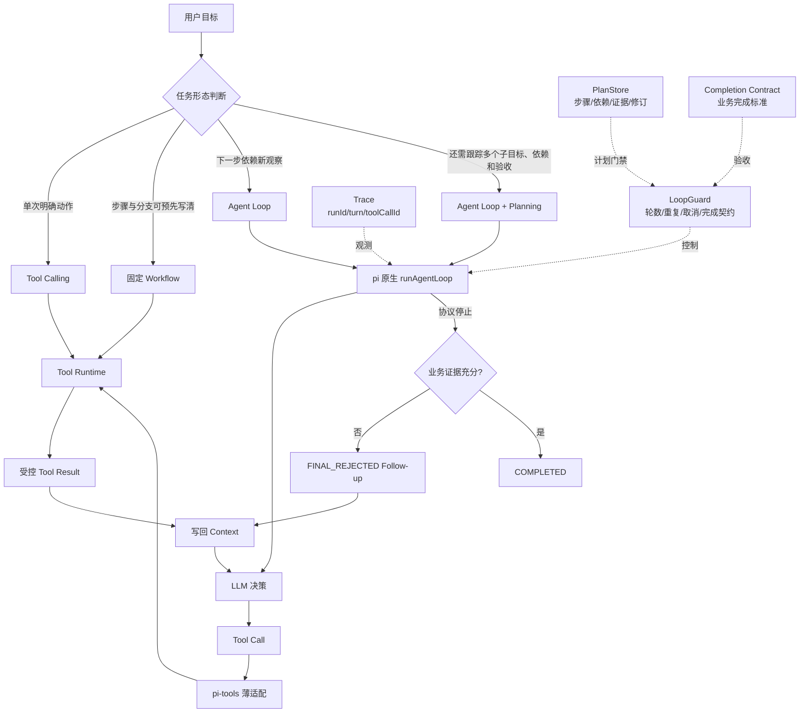

一句话主线：

> Tool Calling 解决“这一次做什么”，Runtime 解决“这一次能否安全执行”，Agent Loop 解决“结果回来后是否继续”，Planning 解决“为了哪个子目标做、做到哪一步、凭什么算完成”。

---

## 1. 3.1：从 Tool Agent 到 Agent Loop

### 1.1 为什么需要 Loop

Chatbot 通常是一问一答；Agent 会经历多轮：

```text
搜索代码 → 读取文件 → 沿调用链取证 → 修改/写产物 → 运行验证
        ↑                                           ↓
        └──────────── 根据真实结果继续纠错 ───────────┘
```

复杂任务需要 Loop，不只是因为步骤多，而是因为：

> 下一步动作依赖上一步产生的新事实。

适合自主 Loop 的任务必须同时满足：

1. 目标清晰；
2. 结果可验证；
3. 过程能持续产生新证据并逐步收敛。

不适合直接自动 Loop 的目标，如“做得更高级”“UI 更好看”，问题在于缺少客观完成标准。

### 1.2 Loop 的两层含义

| 层次 | 解决的问题 | 典型机制 |
| --- | --- | --- |
| 任务内循环 | 一次 Run 中如何观察、决策、调用工具、读取结果并继续 | `runAgentLoop`、Tool Result 回写、Hook |
| 任务外循环 | 什么事件触发 Run、何时再次启动、谁判断总目标完成 | 定时任务、人工触发、工作流、持久化状态 |

易错点：不要把定时任务、Sub-agent、Memory、Skills、Workflow 全部塞进 Agent Loop。3.1 主要实现任务内循环。

### 1.3 四个概念必须分开

| 对象 | 核心问题 | 代码落点 |
| --- | --- | --- |
| Function / Tool Calling | 模型怎样表达下一步动作 | 模型输出 Tool Call |
| Tool Runtime | 动作是否合法、如何执行、结果如何治理 | `runtime.ts` |
| Agent Loop | Tool Result 回来后是否继续 | `runAgentLoop` + Hook |
| LoopGuard | 整个 Run 是否仍允许继续 | `loop-guard.ts` |

边界关系：

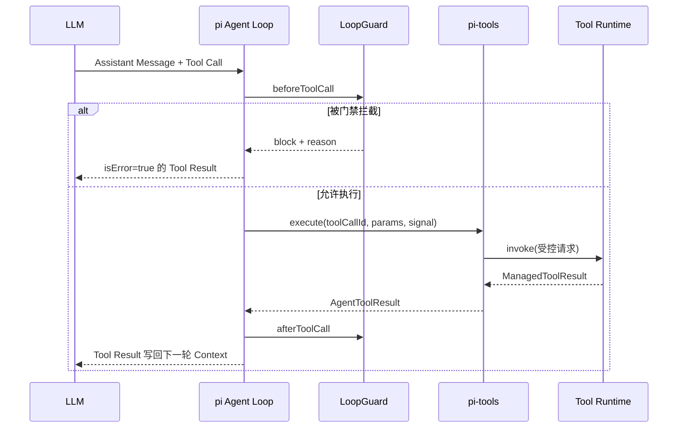

### 1.4 pi Agent Loop 的最小判定

核心只有两种协议情况：

1. Assistant Message 含 Tool Call：执行工具，写回结果，进入下一轮；
2. Assistant Message 不含 Tool Call：当前工具循环准备结束。

但第二条只代表协议层停止，不代表业务完成。

```text
没有 Tool Call ≠ 任务完成
模型说“完成” ≠ 有完成证据
达到最大轮数 ≠ 成功
```

业务完成必须由 Completion Contract 或 `shouldStopAfterTurn` 依据事实判断。

### 1.5 Hook 时序是高频难点

课程使用版本中的实际顺序：

```text
turn_end
  → prepareNextTurn
  → shouldStopAfterTurn
  → getSteeringMessages
  → 自然停止时 getFollowUpMessages
```

这意味着：本轮 Tool Result 形成的证据必须先更新，再做完成校验，否则校验读取不到最新事实。

关键 Hook：

| Hook | 课程中的职责 |
| --- | --- |
| `beforeToolCall` | 重复动作保护；3.2 再增加计划门禁 |
| `afterToolCall` | 只从成功结果收集证据 |
| `prepareNextTurn` | 3.1 预留 Checkpoint；3.2 刷新计划快照 |
| `shouldStopAfterTurn` | 最大轮数与完成契约 |
| `getFollowUpMessages` | 注入 `FINAL_REJECTED`，让同一 Run 继续 |
| `getSteeringMessages` | 当前示例返回空集合，保留干预接缝 |

### 1.6 ReAct、Plan-and-Execute 与 Loop

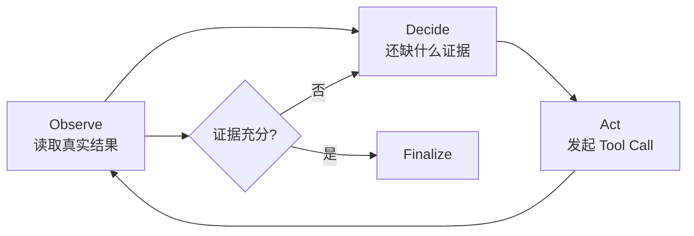

- Loop 是执行发动机：决定“要不要继续”。
- ReAct 是局部导航：决定“下一步往哪走”。
- Plan 是全局路线：决定“总目标拆成哪些阶段”。

代码理解任务通常适合 ReAct，因为文件位置、函数名、调用关系一开始未知；跨模块修复更适合轻量计划 + ReAct。

### 1.7 工程上保存什么

应该保存可审计事实：

```text
Tool Call
+ Runtime 判定
+ Tool Result
+ Observation
+ 停止依据
```

不应把模型完整思维过程当业务状态。恢复任务需要客观事实与状态，不需要复用旧推理。

建议的最小审计键：

- `runId`：一次任务；
- `turn`：第几轮；
- `toolCallId`：连接 Tool Call、Runtime、Tool Result 与 Trace。

### 1.8 LoopGuard 的四个核心保护

#### 保护一：最大轮数

最大轮数是安全边界，不是完成条件。触顶必须返回 `MAX_TURNS_EXCEEDED`，不能伪装成成功。

#### 保护二：重复动作

动作指纹：

```text
SHA-256(工具名 + 递归排序后的参数 JSON)
```

对象字段顺序不同但语义相同，应得到相同指纹。课程规则是前两次允许执行，第三次在 Runtime Handler 之前拦截。

硬验收不是“出现了 REPEATED_ACTION 文本”，而是：

> Handler 实际只执行两次。

生产级检测还应考虑文件是否变化、测试是否改善、是否新增事实、计划是否推进、错误类型是否变化。相同调用不总是死循环，例如修改源码后再次运行同一测试。

#### 保护三：完成契约

3.1 的最低完成证据：

- 至少成功读取 3 个相关源码文件；
- 成功写入 `artifacts/login-flow.md`。

证据只能来自成功 Tool Result；模型文本中的“我已读取”“我已写入”不算证据。

#### 保护四：取消与不可继续状态

以下情况应停止继续请求模型：

- Provider 返回 aborted；
- 用户主动取消；
- 最大轮数或总时间耗尽；
- 不可恢复的权限拒绝；
- 相同动作反复出现；
- 等待人工确认。

中断与恢复不是一回事：

- 中断：停止当前模型和工具；
- 恢复：从可信保存点继续。

重新发送原 Prompt 只是重跑，不是真恢复；对写文件、Git、部署和外部调用，盲目重放可能产生重复副作用。

---

## 2. 3.1 源码架构与代码思路

### 2.1 五层结构

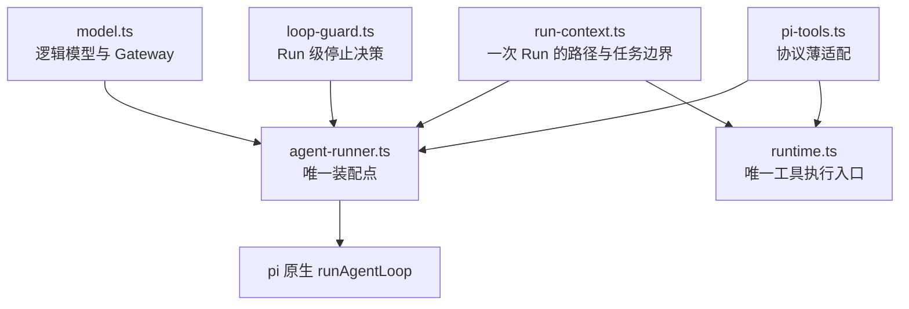

模块职责：

| 文件 | 代码思路 |
| --- | --- |
| `model.ts` | Agent 只认逻辑模型；Gateway 负责供应商选择、路由、重试、Token 与成本统计；密钥只读环境变量 |
| `run-context.ts` | 把 `projectRoot`、`repoRoot`、`artifactRoot`、目标产物收口为可注入上下文；不依赖进程工作目录 |
| `runtime.ts` | 所有工具共用一个 `invoke`；完成参数校验、路径校验、取消、执行、错误归一和结果治理 |
| `pi-tools.ts` | Schema → Runtime 请求 → Tool Result 转换；不得直接访问文件系统或复制治理逻辑 |
| `loop-guard.ts` | 最大轮数、重复动作、证据收集、完成判断、Follow-up |
| `agent-runner.ts` | 创建状态、装配 Context/Tools/Hooks、调用唯一的 `runAgentLoop`、记录 Trace |
| `main.ts` | CLI 启动和结果输出，不重复定义 Prompt、工具、Guard 或 Loop |

### 2.2 统一 Runtime 的不变量

课程 Spec 中最重要的 7 条不变量：

1. `toolCallId` 从 Tool Call → Runtime → Tool Result → Trace 全程不丢失；
2. 模型参数一律视为不可信输入；
3. 所有工具只经过唯一 Runtime，禁止旁路；
4. Tool Result 先治理，再进入模型 Context；
5. 只复用 pi 原生 Agent Loop，不自建第二套循环；
6. 路径 `resolve` 后再验证不越界，写操作只落产物目录；
7. 不硬编码供应商模型和密钥。

`codebasedemo` 强化版比基础版更值得学习的点：

- Runtime 注册表同时绑定 Schema 与 Handler，避免“校验一套、执行另一套”；
- `additionalProperties: false` 拒绝模型臆造参数；
- 路径先解析再检查归属，避免 `artifacts/../x` 绕过；
- 成功和失败统一构造；
- `modelView` 与工程侧 `details/artifact` 分离，控制进入模型的内容；
- 记录 Handler 调用次数，用行为证据证明门禁真的在执行前生效。

### 2.3 login_demo 的业务调用链

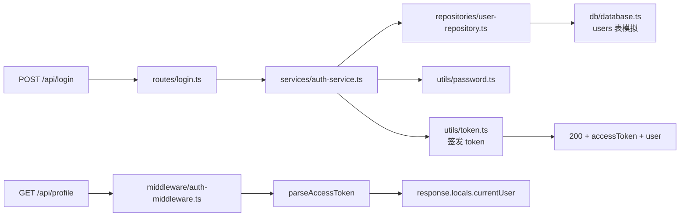

这里是教学 Demo：密码“哈希”和 Token 都是可预测的简化实现，不能照搬到生产环境。

### 2.4 3.1 行为验收

脚本化模型响应负责稳定复现边界：

1. Tool Result 写回后，模型被调用第二次；
2. 无交付证据时拒绝 Final，并注入 `FINAL_REJECTED`；
3. 第三次重复调用被拦截，Handler 仅执行两次；
4. 最大轮数为 3 时，没有第四次模型调用；
5. 取消后不再开始工具执行；
6. 真实工具闭环生成可核验 Markdown，并能用 `runId/turn/toolCallId` 还原轨迹。

测试原则：

> 脚本化测试证明机制存在；真实 Gateway 集成证明机制能够工作。

---

## 3. 3.2：Planning 与任务拆解

### 3.1 Planning 解决什么

Loop 有消息历史，能知道“做过什么”，但不能可靠回答：

- 当前还差哪几步；
- 某个结论被新证据推翻后，哪些步骤失效；
- 哪些验证需要重做；
- 当前改动是否满足交付标准。

Planning 增加四类工程状态：

```text
计划状态 + 计划操作 + 结构化证据 + 完成契约
```

它不是“写一段更严厉的提示词”，而是增加一层由程序维护的任务结构。

### 3.2 四种执行方式如何选

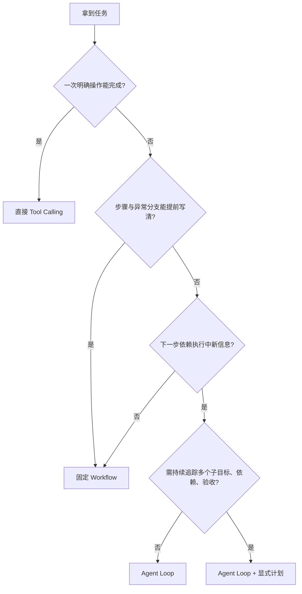

不要把“会根据工具结果调整下一步”当成必须 Planning 的充分条件；普通 Agent Loop 也能调整。Planning 的触发点是需要长期、显式地追踪多个子目标、依赖和验收条件。

### 3.3 计划步骤要写“新事实”，不要写模糊动作

| 模糊动作 | 可验收子目标 | 可接受证据 |
| --- | --- | --- |
| 分析代码 | 确认失败入口、相关模块和可证伪假设 | 文件位置、调用链、失败断言摘要 |
| 修改代码 | 完成允许范围内的最小修改 | 受控 Diff、修改理由 |
| 跑测试 | 指定范围退出码为 0 | 命令、退出码、测试范围、代码版本 |
| 修复缺陷 | 原问题消失且有防回归验证 | 修复前后对比、边界与回归结果 |

记忆法：

> Objective 写“完成后新增什么事实”；SuccessCriteria 事前定义；Evidence 事后收集。

### 3.4 Planning 数据模型

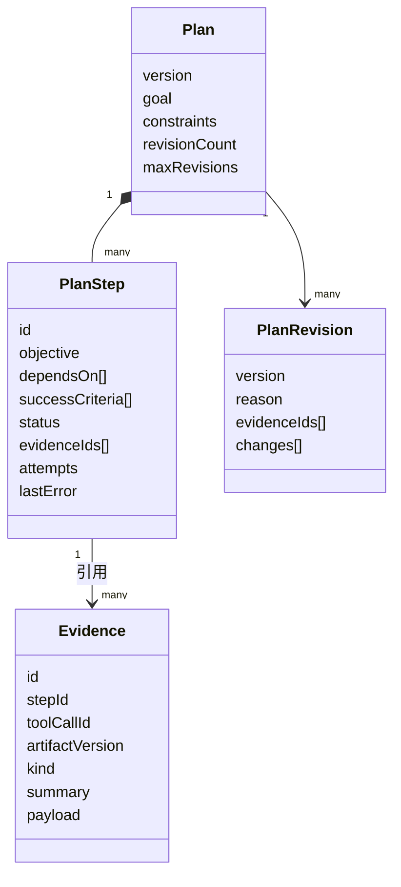

六种步骤状态：

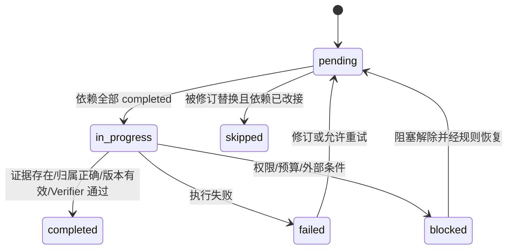

关键不变量：

- `skipped` 不等于 `completed`，不能满足下游依赖；
- `readySteps()` 由程序计算，不由模型宣布；
- 计划必须保证步骤 ID 唯一、依赖存在、依赖图无环；
- 依赖就绪不代表没有资源冲突，并发修改同一文件仍需隔离。

### 3.5 完成申请的四道证据门

```mermaid
flowchart TD
    A[complete(stepId, evidenceIds)] --> B{证据非空?}
    B -->|否| E1[PLAN_COMPLETION_REQUIRES_EVIDENCE]
    B -->|是| C{证据均存在?}
    C -->|否| E2[PLAN_UNKNOWN_EVIDENCE]
    C -->|是| D{stepId 与步骤一致?}
    D -->|否| E3[PLAN_EVIDENCE_STEP_MISMATCH]
    D -->|是| E{test/diff 属于当前代码版本?}
    E -->|否| E4[PLAN_EVIDENCE_STALE]
    E -->|是| F{StepVerifier 满足 successCriteria?}
    F -->|否| E5[PLAN_COMPLETION_REJECTED]
    F -->|是| G[status = completed]
```

为什么要 `artifactVersion`：修改代码后，旧版本上的测试通过不能证明当前版本可交付。

为什么失败结果也能成为证据：证据表示“发生过的真实事实”，不等于“成功”。例如复现步骤的完成标准就是目标测试应失败。因此不能用 `exitCode === 0` 粗暴映射步骤完成，必须结合该步骤事前定义的标准。

### 3.6 计划修订：改路径，不降标准

修订流程：

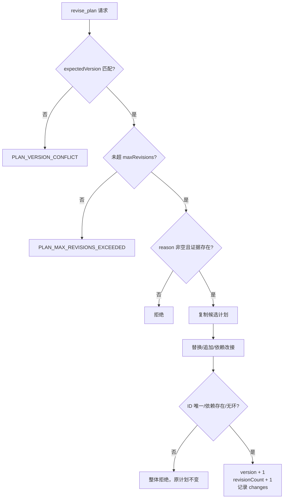

三条硬规则：

1. 乐观锁：请求携带 `expectedVersion`，防止旧申请覆盖新计划；
2. 原子提交：在候选副本上完成全部变更并校验，成功后一次替换；
3. 修订预算：限制 `maxRevisions`，防止无限重规划。

模型可以改变执行路径，但不能：

- 把“回归测试通过”降成“尝试运行过”；
- 删除必要测试或断言；
- 用修订绕过权限、预算和人工确认；
- 假装撤销已经发生的不可逆外部副作用。

### 3.7 失败先分类，再决定是否修订

| 结果类型 | 正确处置 | 通常是否修订 |
| --- | --- | --- |
| 参数或路径拼错 | 局部纠错后重试 | 否 |
| 暂时性超时 | 在预算内受控重试 | 否 |
| assertion | 检查实现、预期或根因假设 | 假设被推翻时是 |
| environment | 先恢复依赖、配置或 fixture | 需要时加准备步骤 |
| infrastructure | 记录阻塞，按平台策略处理 | 不能靠改计划绕过 |
| 用户新增约束 | 检查已有 Diff，使冲突步骤与旧验收失效 | 是 |

核心判断：

> 是动作参数错了，还是计划前提错了？

失败次数多不等于计划必须修订；只有目标、假设、依赖或约束变化，才需要修订。

---

## 4. 3.2 源码架构与演进思路

### 4.1 对照组先补齐“同样的能力”

`3-2/codebase_agent_demo` 并非原样照搬 3.1。它先加入：

- `apply_patch`：唯一锚点替换，成功后代码版本递增；
- `run_test`：只允许 `target/boundary/regression` 三个约定范围；
- `ToolEvidence`：Runtime 产出 `inspection/diff/test/tool` 证据草稿；
- 可注入 Completion Contract：修复任务要求当前版本有改动、三类测试通过、有交付说明。

这样 Planning 组与非 Planning 组拥有相同工具和完成标准，两者差别才能归因于计划层。

### 4.2 Planning 版增加的模块

| 新增/修改文件 | 关键作用 |
| --- | --- |
| `plan-store.ts` | Plan、Step、Evidence、状态转换、依赖校验、原子修订 |
| `plan-tools.ts` | `create_plan/get_plan/update_plan_step/revise_plan`；模型提申请，Handler 改状态 |
| `planning-prompt.ts` | 首轮规划规则 + 每轮替换的计划快照 |
| `completion-contract.ts` | 完成条件可注入，并要求计划步骤完成 |
| `pi-tools.ts` | 工具参数增加 `planStepId`，并新增计划工具 |
| `loop-guard.ts` | 在原重复保护上增加计划门禁，把 Runtime 证据绑定到步骤 |
| `agent-runner.ts` | 装配 `PlanningSession`，在既有四个 Hook 上接计划层 |

pi 的 `runAgentLoop` 一行未改。是否“另写了第二套 Loop”，看模型调用、工具执行、结果回写是否仍由 pi 掌握。

### 4.3 `planStepId` 为什么必须在 Runtime 前剥离

`planStepId` 是计划治理字段，不是业务工具参数：

```text
模型 Tool Call
  → beforeToolCall 用 planStepId 校验步骤门禁
  → pi-tools 删除 planStepId
  → Runtime 只接收业务参数
  → afterToolCall 再用原 Tool Call 的 planStepId 绑定 Evidence
```

这样可以避免 Runtime 被计划层细节污染，同时保证执行前门禁与执行后证据归属都可追踪。

### 4.4 计划门禁必须发生在 Handler 前

以下工具属于受治理动作：

- `write_file`；
- `apply_patch`；
- `run_test`。

已有计划时，它们必须携带 `planStepId`，且步骤必须就绪或进行中。门禁失败后 Handler 调用次数必须为 0。

只在 Prompt 中写“遵守依赖”不够；真正的依赖控制必须在执行接缝上由程序强制执行。

### 4.5 每轮计划快照为何“替换”而非“追加”

`prepareNextTurn` 重新生成当前计划视图，只保留：

- 计划版本与修订预算；
- 当前就绪步骤；
- 进行中、阻塞、失败、已完成状态；
- 最近少量证据。

若把每个历史计划完整追加到 Context，会造成 Token 膨胀、版本冲突和模型误读旧状态。原始 Tool Result 仍由 pi 正常写回，计划快照不能替代工具结果。

### 4.6 示例缺陷：会话到期边界

错误实现把时间截断到日期：

```ts
const expiresOn = session.expiresAt.slice(0, 10);
const currentDay = now.toISOString().slice(0, 10);
return expiresOn < currentDay;
```

问题：同一天内即使已经超过具体过期时刻，两个日期字符串仍相等，导致已过期会话被判为有效。

最小修复语义：

```ts
return Date.parse(session.expiresAt) <= now.getTime();
```

到期时刻即过期，因此是 `<=`，不是 `<`。

六步可验收拆解：

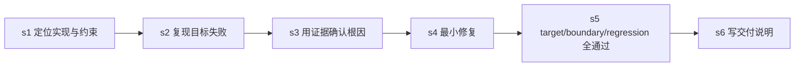

### 4.7 非 Planning 与 Planning 的真实运行对比

| 项目 | 非 Planning | Planning |
| --- | ---: | ---: |
| 轮数 | 8 | 17 |
| 工具调用记录 | 38 | 77 |
| 停止原因 | COMPLETED | COMPLETED |
| 代码版本 | 未展示计划版本 | r1 |
| 计划版本 | 无 | v1 |
| 计划修订 | 无 | 0 次 |
| 步骤级证据 | 无 | s1-s6：4/1/1/1/3/1 |

不要把 8 vs 17 解读为 Planning 更低效。额外调用用于创建/读取计划、绑定步骤、补齐步骤级证据与分层验收。它的价值是：

> 结论可解释、过程可追踪、完成可复核。

真实 Planning 运行没有触发动态修订；模型一次锁定根因。动态重规划能力是由确定性测试证明的，不能把“支持修订”误写成“真实运行发生过修订”。

---

## 5. 重难点关系图

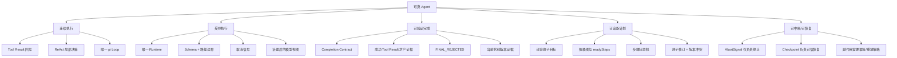

### 最容易混淆的 10 组概念

| A | B | 区别 |
| --- | --- | --- |
| 没有 Tool Call | 业务完成 | 前者是协议信号，后者必须有证据 |
| 最大轮数 | 完成条件 | 前者是安全上限，触顶表示未完成 |
| 重复调用 | 死循环 | 上下文或外部状态变化时，重复调用可能合理 |
| 中断 | 恢复 | 中断停止当前执行；恢复从可信快照继续 |
| ReAct | Planning | ReAct 管局部下一步；Planning 管全局子目标与依赖 |
| Workflow | Planning | Workflow 的结构固定；动态计划允许依据证据修订路径 |
| successCriteria | Evidence | 前者事前定义；后者事后产生 |
| Evidence | 成功 | 证据是事实，失败结果也可证明“复现完成” |
| skipped | completed | 跳过不能满足依赖，除非修订改接 |
| Prompt 约束 | 程序门禁 | Prompt 是软约束；执行前 Hook 是硬约束 |

---

## 6. 错误码与它们保护的系统属性

| 错误码 | 保护的属性 |
| --- | --- |
| `REPEATED_ACTION` | 防止无进展重复与副作用重复 |
| `MAX_TURNS_EXCEEDED` | 控制资源预算，不伪装成功 |
| `FINAL_REJECTED` | 协议停止不能绕过业务完成契约 |
| `PLAN_STEP_REQUIRED` | 受治理动作必须绑定计划步骤 |
| `PLAN_STEP_NOT_READY` | 依赖门禁在 Handler 前生效 |
| `PLAN_COMPLETION_REQUIRES_EVIDENCE` | 禁止无证据完成 |
| `PLAN_UNKNOWN_EVIDENCE` | 禁止引用不存在事实 |
| `PLAN_EVIDENCE_STEP_MISMATCH` | 禁止跨步骤挪用证据 |
| `PLAN_EVIDENCE_STALE` | 禁止旧代码版本证据用于当前交付 |
| `PLAN_COMPLETION_REJECTED` | StepVerifier 语义验收失败 |
| `PLAN_SKIP_REQUIRES_REWIRE` | 跳过前必须清理下游依赖 |
| `PLAN_VERSION_CONFLICT` | 防止旧计划申请覆盖新版本 |
| `PLAN_MAX_REVISIONS_EXCEEDED` | 防止无限重规划 |
| `PLAN_DEPENDENCY_CYCLE` | 保证依赖图可执行 |
| `PATH_DENIED` / `ARTIFACT_PATH_DENIED` | 防止路径越界与非授权写入 |

---

## 7. 面试/自测题

### Q1：为什么不能以模型的 Final 文本作为完成依据？

因为模型可能漏读代码、忘记写产物、工具失败后提前停止或只完成一部分。完成必须由成功 Tool Result 形成的可验证证据决定。

### Q2：为什么第三次重复动作要在 Handler 前拦截？

否则副作用已经发生，只是事后打标签；Handler 实际执行次数为 2 才能证明门禁真正有效。

### Q3：为什么计划不能只有 `completed: boolean`？

实际步骤至少需要 pending、in_progress、completed、blocked、skipped、failed。不同状态对依赖、恢复和修订的语义不同。

### Q4：为什么证据要绑定 `artifactVersion`？

代码修改后，旧版本上的测试结果不再能证明当前代码正确；否则会出现“测试绿过，但不是这版代码”的假交付。

### Q5：为什么 Planning 不应重写 Agent Loop？

Planning 是任务状态与门禁层，应复用既有模型调用、工具执行和结果回写通道。另写循环会产生两套执行语义、重复治理和难以追踪的状态。

### Q6：为何 `planStepId` 不应传入 Runtime Handler？

它是治理元数据，不是业务参数。Hook 用它做依赖校验与证据归属，适配层应在 Runtime 前剥离。

### Q7：为什么一次失败测试不一定意味着要修订计划？

可能只是参数、路径、环境或基础设施问题。只有失败推翻了原假设、依赖或约束时，才需要修订。

### Q8：怎样判断系统真的只有一条 Loop 和一条工具路径？

检查模型调用是否只进入 `runAgentLoop`，工具执行是否只进入 `Runtime.invoke`，Tool Result 是否只由 pi 回写；装配层、计划层和适配层都不应旁路调用模型或文件系统。

---

## 8. 最小复习清单

学完应能独立说明：

- [ ] Tool Calling、Runtime、Agent Loop、LoopGuard 的边界；
- [ ] Tool Result 如何进入下一轮 Context；
- [ ] 为什么“没有 Tool Call”不等于完成；
- [ ] `beforeToolCall/afterToolCall/prepareNextTurn/shouldStopAfterTurn` 的职责与顺序；
- [ ] 动作指纹为何要递归排序参数；
- [ ] Completion Contract 如何把“完成”变成可测试代码；
- [ ] Abort 与 Checkpoint 恢复的区别；
- [ ] 何时选 Tool Calling、Workflow、Loop、Planning；
- [ ] PlanStep、Evidence、PlanRevision 的关系；
- [ ] `skipped` 为什么不能满足依赖；
- [ ] 证据为何必须有 `stepId/toolCallId/artifactVersion`；
- [ ] 修订为何需要 expectedVersion、候选副本和 maxRevisions；
- [ ] 计划门禁为何必须在 Handler 前；
- [ ] 如何用行为测试证明规则真的生效。

最终记忆链：

```text
明确目标
  → 真实工具取证
  → Tool Result 回写
  → Loop 持续推进
  → Guard 控制停止
  → Plan 管理子目标与依赖
  → Evidence 证明步骤
  → Completion Contract 决定交付
```

---

## 9. 源码阅读索引

建议按以下顺序复习：

1. `3-1/codebasedemo/codebasedemo/src/agent-runner.ts`：先看唯一 Loop 如何装配；
2. `3-1/codebasedemo/codebasedemo/src/loop-guard.ts`：理解协议停止与业务完成；
3. `3-1/codebasedemo/codebasedemo/src/runtime.ts`：理解唯一受控执行入口；
4. `3-1/codebasedemo/codebasedemo/src/pi-tools.ts`：理解薄适配；
5. `3-2/codebase_agent_demo/codebase_agent_demo/src/completion-contract.ts`：看无计划对照组如何抽取完成契约；
6. `3-2/planning_agent_demo/planning_agent_demo/src/plan-store.ts`：计划层核心；
7. `3-2/planning_agent_demo/planning_agent_demo/src/plan-tools.ts`：模型申请与 Handler 改状态的边界；
8. `3-2/planning_agent_demo/planning_agent_demo/src/loop-guard.ts`：计划门禁和证据绑定；
9. `3-2/planning_agent_demo/planning_agent_demo/src/agent-runner.ts`：四个 Hook 如何把计划层接入原 Loop；
10. 两个测试文件：`tests/plan-store.test.ts` 与 `tests/agent-runner.test.ts`，从反例理解不变量。

