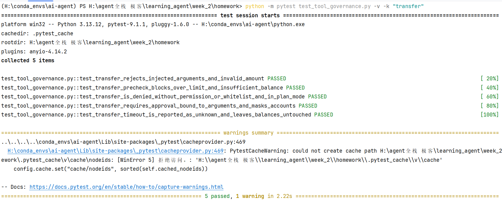

# 转账工具治理作业

## 本次改动说明

- 新增 `ACCOUNTS` 模拟账户数据，并按“租户 + 账户号”隔离账户余额。
- 新增 `TransferArgs`，校验转出账户、转入账户和转账金额，并拒绝未声明的注入字段。
- 新增转账业务预检：拦截教学额度区间，并在执行前校验转出账户余额。
- 新增高风险 `transfer` 工具：需要 `transfer:execute` 权限、人工审批和参数摘要绑定；写操作超时返回 `TIMEOUT_UNKNOWN`。
- 转账成功后更新双方余额，返回交易编号；账号在返回结果与审计记录中统一脱敏为 `ACC-A-****3456` 格式。

## 测试运行命令

```powershell
cd "H:\agent全栈 极客\learning_agent\week_2\homework"
python -m pytest test_tool_governance.py -v -k "transfer"
```

## 测试通过截图


