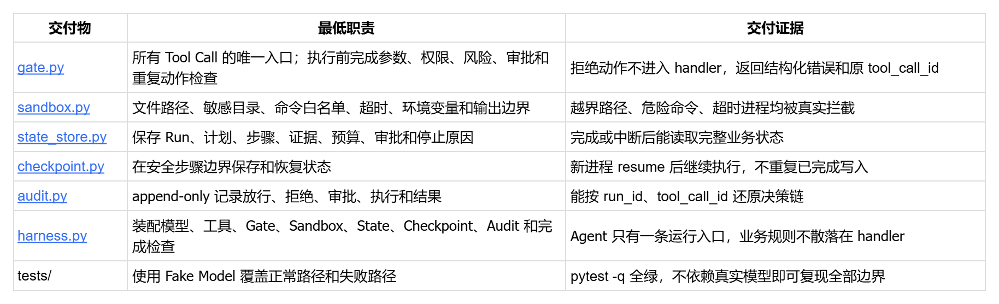
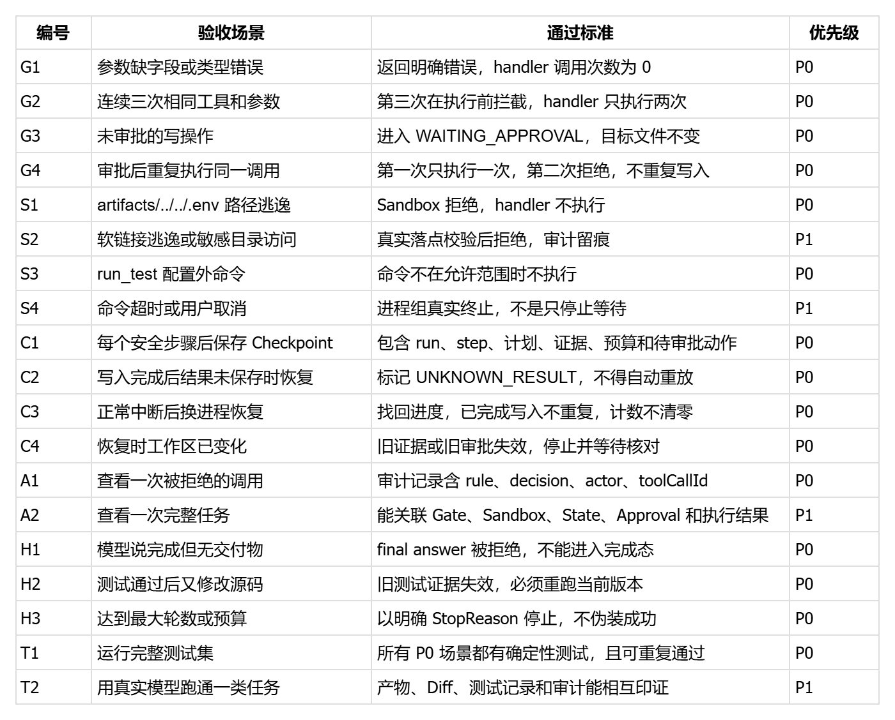

基于 smolagents 实现 Guarded Harness
# 作业问题
在不重写 smolagents 核心的前提下，为 ToolCallingAgent 增加一层可恢复的 Guarded Coding Harness。模型继续负责决策，程序负责门禁、执行边界、状态、审计、恢复和最终验收，使其能够安全完成“代码理解”和“测试修复”两类仓库任务。
smolagents github：https://github.com/huggingface/smolagents
# 必须交付


测试文件：
```
tests/test_gate.py
tests/test_sandbox.py
tests/test_state_checkpoint.py
tests/test_audit.py
tests/test_harness_loop.py
tests/test_completion.py
```


# 核心验收


# 最后提交
- 源码与测试。
- pytest -q 实际结果。
- 至少一条完整运行记录。
- 一份审计记录。
- 一份 Checkpoint 恢复记录。